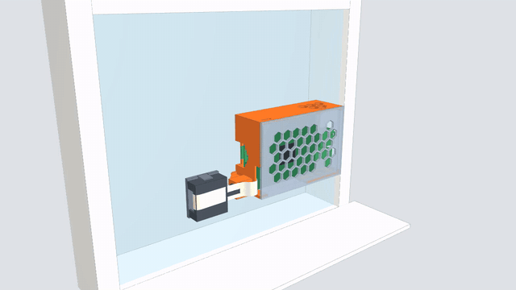

# Raspberry Pi 5 window camera mount

A 3D-printable mount that sticks a **Raspberry Pi 5 + Camera Module 3** to the inside of a window, for watching the
street.



- The **Pi** sits in a light honeycomb case, parallel to the glass.
- The **camera** sits in a small box on a ball joint next to the case and looks out through the glass. You aim it by
  hand, about ±30° up/down and sideways, and friction holds it there.
- A small **pad** is taped to the glass. The case slides down onto it and lifts off again, so the pad stays on the window.
- **6 printed parts, no supports, PETG.** They snap together. The only screws are the 4 that hold the Pi.

> **Status: first release, not fully print-tested yet.** Print the [test parts](#2-print) first and please report how
> they fit.

## 1. What you need

| | item | notes |
|---|---|---|
| 1 | Raspberry Pi 5 | one HAT fits with the default case depth |
| 1 | Raspberry Pi Camera Module 3 | standard or NoIR (same board). Wide: same board, not checked |
| 1 | Pi 5 camera cable, 22-pin → 15-pin, 200 mm | the standard one |
| 0-4 | M2.5 self-tapping screws, ~6 mm | Pi into the case standoffs (works also without)|
| 4 | strips of double-sided foam tape (tesa / 3M VHB), ~16 × 6 mm | pad to the glass |


## 2. Print

The STLs in [`stl/`](stl/) are exported **in assembled position**, so turn each one onto the face below.
The parts were laid out on a Prusa CORE One (0.4 mm nozzle, 0.15 mm layers, PETG), but nothing in them is printer-specific.

| part | file | face on the bed |
|---|---|---|
| Case | `case.stl` | back plate |
| Cover | `cover.stl` | outer face (flip) |
| Window pad | `window_pad.stl` | tape face, U-walls up |
| Connector | `connector.stl` | groove face, pegs up |
| Camera housing | `cam_housing.stl` | back face: ball flat and neck on the bed, open side up (flip) |
| Camera lid | `cam_lid.stl` | outside (lens) face |

No supports needed. All overhangs are 45° or less, except the short 60° roof of the big hex hole in the case's
microSD wall, so check that one in your slicer.


If something is too tight or too loose, change `fit` or `ball_interf` in the model and re-export
(see [Changing the design](#changing-the-design)).

With PrusaSlicer, [`tools/prusaslicer/plate.py`](tools/prusaslicer/README.md) can turn the parts and lay them out on a plate for you
(Python 3, no dependencies):

```sh
python3 tools/prusaslicer/plate.py stl/plate.json                 # all parts → stl/plates/rpi5_window_cam.3mf
python3 tools/prusaslicer/plate.py stl/plate.json --only Connector,CamHousing,CamLid -o stl/plates/test_fit.3mf
```

## Good to know

- The camera is mounted upside down, so rotate the image 180°: `rpicam-still --rotation 180`, or `hflip` + `vflip` in
  libcamera / Picamera2.
- For night use, turn off the Pi's LEDs in `config.txt`. Otherwise they shine through the cover and reflect in the glass.
- Tilting the camera fully down **and** fully sideways at the same time can push the far corner of the lid against the glass.

## Changing the design

The model and the print prep were made with **[Claude Code](https://claude.com/claude-code)**, driving two apps through
MCP servers:

- **[SolidCraft](https://solidcraft.io)** ([GitHub](https://github.com/tangency-labs/solidcraft)), an open-source
  parametric CAD app with a built-in MCP server. The model is [`rpi5_window_cam.solidcraft`](rpi5_window_cam.solidcraft):
  all six parts in assembled position, plus the official Raspberry Pi 5 and Camera Module 3 models for fit checks.
  Case depth (room for a HAT), wall thickness, `fit` and `ball_interf` are parameters.
- **PrusaSlicer**, through a small MCP server in [`tools/prusaslicer/`](tools/prusaslicer/README.md). It turns the parts
  onto their print faces, packs the plate, loads it into the PrusaSlicer window and slices.

To work on it the same way:

1. Install SolidCraft (0.23.1 or newer) and PrusaSlicer (2.9, flatpak `com.prusa3d.PrusaSlicer`).
2. Start SolidCraft with the design and its control port, from the repo root:

   ```sh
   solidcraft --control 7878 rpi5_window_cam.solidcraft
   ```

3. Open PrusaSlicer with your printer, print and filament presets selected.
4. Start `claude` in the repo root and approve the two servers from [`.mcp.json`](.mcp.json): `solidcraft`
   (`solidcraft-cli mcp --connect 127.0.0.1:7878`, drives the open window) and `prusaslicer`
   (`python3 tools/prusaslicer/mcp.py`).
5. Ask in plain words, e.g. *"set fit to 0.25 and re-export the STLs"* or *"arrange the connector and camera parts on a
   test plate"*. [`CLAUDE.md`](CLAUDE.md) gives Claude the model's coordinates, export rules and SolidCraft quirks.

Without Claude Code, open the design in SolidCraft and change the parameters by hand, or start from the STLs in other
CAD software.

```
rpi5_window_cam.solidcraft   parametric model (all parts + Raspberry Pi reference models)
stl/                         printable parts (assembled position) + plate.json (print orientation per part);
                             external/ = Pi and camera meshes for the animation
anim/                        storyboard → purpose.gif (the animation above)
tools/                       PrusaSlicer MCP + plate tool, animation renderer (Python stdlib / Node, no dependencies)
CLAUDE.md                    project notes for Claude Code
```
